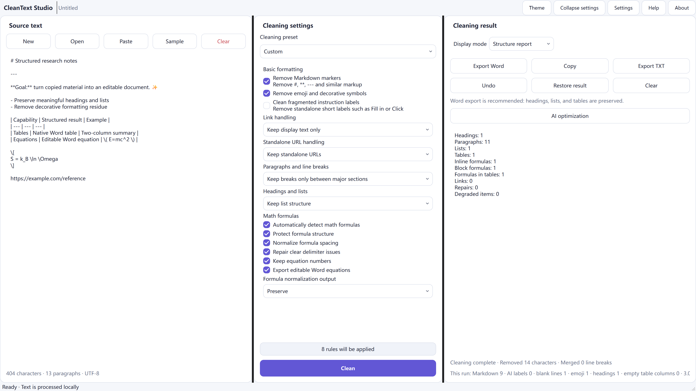
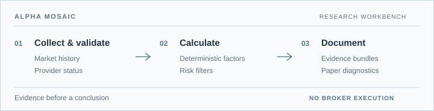
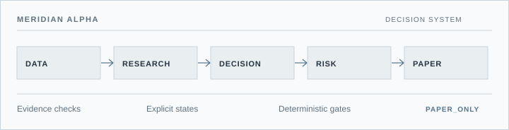

# Siri Zhao

**Independent developer · software and research systems**

I'm an agronomy undergraduate at Nanjing Agricultural University, building a deeper foundation in computer science through real software projects. I work on desktop tools, quantitative research infrastructure, and learning workflows. Across them, I care about clear inputs, inspectable decisions, and honest boundaries.

`Agronomy` · `Computer Science foundations` · `Software & research engineering`

[Selected work](#selected-work) · [Toolkit](#toolkit) · [Activity](#activity)

---

## Selected work

### 01 / CleanText Studio

<picture>
  <source media="(prefers-color-scheme: dark)" srcset="assets/projects/cleantext-dark.png">
  <source media="(prefers-color-scheme: light)" srcset="assets/projects/cleantext-light.png">
  
</picture>

**Document engineering for everyday work.** CleanText Studio turns copied or AI-assisted text into editable documents while retaining useful structure. A shared document tree powers preview and DOCX export; basic cleanup runs locally, with optional AI refinement initiated by the user.

`Python` · `Desktop application` · `Document processing` 
[Source](https://github.com/SiriZhao/CleanText-Studio) · [Latest release](https://github.com/SiriZhao/CleanText-Studio/releases/latest)

### 02 / Alpha Mosaic

<picture>
  <source media="(max-width: 600px) and (prefers-color-scheme: dark)" srcset="assets/projects/alpha-mobile-dark.svg">
  <source media="(max-width: 600px) and (prefers-color-scheme: light)" srcset="assets/projects/alpha-mobile-light.svg">
  <source media="(prefers-color-scheme: dark)" srcset="assets/projects/alpha-dark.svg">
  <source media="(prefers-color-scheme: light)" srcset="assets/projects/alpha-light.svg">
  
</picture>

**An evidence-first quantitative research workbench.** It discovers a bounded US equity universe, validates available market data, computes deterministic factors, and saves research reports. Historical replay is diagnostic and paper evaluation remains separate from live trading; the project makes no claim of demonstrated alpha.

`Python` · `OpenBB integration` · `Read-only MCP` 
[Source](https://github.com/SiriZhao/alpha-mosaic) · [Architecture](https://github.com/SiriZhao/alpha-mosaic/blob/main/ARCHITECTURE.md)

### 03 / Meridian Alpha

<picture>
  <source media="(max-width: 600px) and (prefers-color-scheme: dark)" srcset="assets/projects/meridian-mobile-dark.svg">
  <source media="(max-width: 600px) and (prefers-color-scheme: light)" srcset="assets/projects/meridian-mobile-light.svg">
  <source media="(prefers-color-scheme: dark)" srcset="assets/projects/meridian-dark.svg">
  <source media="(prefers-color-scheme: light)" srcset="assets/projects/meridian-light.svg">
  
</picture>

**Decision support with explicit gates.** Meridian connects research evidence to deterministic risk checks, status-aware reports, and a persistent paper ledger. It is an independent project from Alpha Mosaic. Its current boundary is `PAPER_ONLY`: broker orders and real-account execution are disabled.

`Python` · `Stateful workflows` · `Audit trails` 
[Source](https://github.com/SiriZhao/meridian-alpha) · [System boundaries](https://github.com/SiriZhao/meridian-alpha/blob/main/docs/adr/ADR-001-system-boundaries.md)

## Further work

**[RecallForge AI](https://github.com/SiriZhao/recallforge-ai)** — A full-stack study workspace that turns course materials into source-anchored review, active recall, and exportable study packs. Generated material remains a study aid to verify against its sources. `FastAPI` · `React` · [v0.6.0 release](https://github.com/SiriZhao/recallforge-ai/releases/tag/v0.6.0)

**[RecallForge Skill](https://github.com/SiriZhao/recallforge-skill)** — A host-executed Agent Skill for inspecting learning materials, reconstructing course knowledge, and testing recall. Visual understanding depends on the selected host's capabilities. `Agent Skills` · `Python` · [v2.2.0 release](https://github.com/SiriZhao/recallforge-skill/releases/tag/v2.2.0)

## Toolkit

**Built with** — Python, TypeScript, FastAPI, React, GitHub Actions, SQLite. 
**Exploring** — agent tool interfaces, reliable LLM applications, quantitative research methods, and computer science foundations.

## Activity

<picture>
  <source media="(prefers-color-scheme: dark)" srcset="assets/generated/activity-dark.svg">
  <source media="(prefers-color-scheme: light)" srcset="assets/generated/activity-light.svg">
  
</picture>

Contribution trail

<picture>
  <source media="(prefers-color-scheme: dark)" srcset="assets/generated/snake-dark.svg">
  <source media="(prefers-color-scheme: light)" srcset="assets/generated/snake-light.svg">
  
</picture>

Activity assets are regenerated through this repository's [GitHub Actions](https://github.com/SiriZhao/SiriZhao/actions). The contribution trail uses [snk](https://github.com/Platane/snk) and stays secondary to the project notes above.

---

[Explore all public repositories](https://github.com/SiriZhao?tab=repositories)
