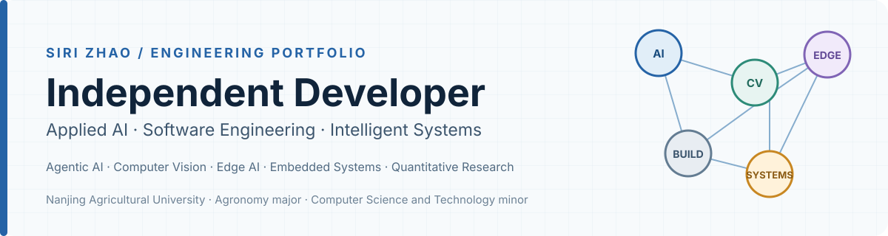
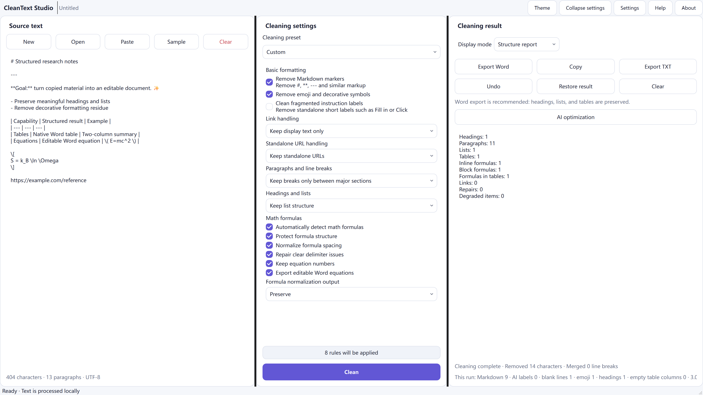
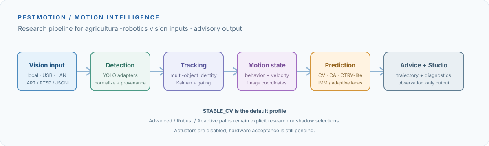
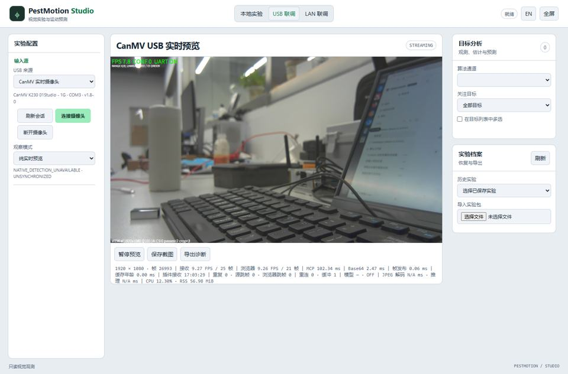
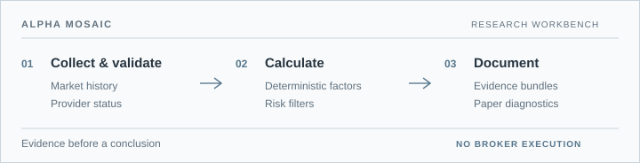
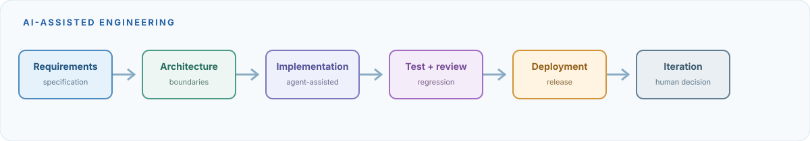

<a href="README.zh-CN.md">简体中文</a> · <strong>English</strong>

  <picture>
    <source media="(prefers-color-scheme: dark)" srcset="assets/profile/hero-dark.svg">
    <source media="(prefers-color-scheme: light)" srcset="assets/profile/hero-light.svg">
    
  </picture>

**Independent Developer — Applied AI, Software Engineering & Intelligent Systems**

`Agentic AI` · `Computer Vision` · `Edge AI` · `Embedded Systems` · `Quantitative Research`

<a href="#about-me">About</a> · <a href="#featured-projects">Featured projects</a> · <a href="#technical-stack">Stack</a> · <a href="#engineering-capabilities">Capabilities</a> · <a href="#github-activity">Activity</a> · <a href="#contact--links">Contact</a>

I build software systems that make their assumptions, boundaries, and outputs inspectable. My work sits at the intersection of **applied AI, software engineering, computer vision, edge computing, embedded systems, and quantitative research**.

**Nanjing Agricultural University** · Agronomy major · Computer Science and Technology minor

## About Me

My main development language is Python, complemented by C/C++ and JavaScript/TypeScript. I enjoy taking a problem from a written specification through architecture, implementation, testing, packaging, and release. Current work ranges from a cross-platform document application to a private agricultural-robotics research system and evidence-driven quantitative tools.

The common thread is research engineering: build a useful prototype, record what was actually tested, keep uncertain results visible, and leave a system that another person can inspect and extend.

## Featured Projects

### 01 / CleanText Studio

<picture>
  <source media="(prefers-color-scheme: dark)" srcset="assets/projects/cleantext-dark.png">
  <source media="(prefers-color-scheme: light)" srcset="assets/projects/cleantext-light.png">
  
</picture>

**Local-first document processing for Windows, macOS, and Linux.** CleanText Studio turns copied pages, Markdown, HTML, TXT, and supported DOCX files into editable documents without flattening useful structure. Its **Document Structure Recovery Engine** produces one canonical `DocumentTree` consumed by text view, preview, validation, and DOCX export.

- Markdown and HTML structure recovery for headings, lists, links, quotes, code, tables, and paragraphs.
- Native DOCX import with merged-cell preservation and source-aware structure handling.
- A shared formula AST for supported LaTeX and Word OMML, with editable OMML equations on export.
- Native Word tables and formulas rather than a text-only approximation.
- Local cleanup, preview, and export by default; optional AI refinement is explicitly user initiated.
- Real Qt desktop UI, automated tests, versioned releases, cross-platform packaging, and checksum-backed delivery.

`Python` · `Qt desktop` · `Markdown / HTML / DOCX` · `LaTeX AST / OMML` · `local-first`

[Source](https://github.com/SiriZhao/CleanText-Studio) · [v2.1.0 release](https://github.com/SiriZhao/CleanText-Studio/releases/tag/v2.1.0) · [Latest releases](https://github.com/SiriZhao/CleanText-Studio/releases)

#### CleanText Studio — Anna-compatible Edition

An Anna-compatible adaptation was developed as an extension of the same CleanText core. The private integration work added Anna Sampling, APS Files DOCX import/export with hash verification, Schema 4 SPA wiring, Executa JSON-RPC integration, and stricter validation around the host contract. The adaptation is a **draft, unpublished app** with a frozen `1.0.0` app version bound to an `Executa 0.1.0` tool; it has no public source repository or public release link. It is shown here as an engineering extension of CleanText Studio, not as a second public product.

### 02 / PestMotion — Motion Intelligence for Agricultural Robotics

<picture>
  <source media="(prefers-color-scheme: dark)" srcset="assets/profile/pestmotion-architecture-dark.svg">
  <source media="(prefers-color-scheme: light)" srcset="assets/profile/pestmotion-architecture-light.svg">
  
</picture>

Real Windows Studio capture from the local USB/CanMV validation record; the frame is shown as evidence of the workbench surface, not as a claim of completed Jetson/K230 acceptance.

**Research-oriented motion intelligence for agricultural-robotics vision inputs.** PestMotion converts external detection streams and K230 UART v1.1 reports into typed frames, then connects multi-object tracking, image-coordinate motion estimation, short-horizon prediction, replay, diagnostics, and observation-only planning advice.

**Algorithm engineering**

Multi-object identity management · Kalman filtering · Mahalanobis-distance gating · Constant Velocity and Constant Acceleration prediction · acceleration-compensated prediction · CTRV-lite · Prediction IMM · adaptive and field-adaptive model selection · behavior-aware motion estimation · shadow evaluation and model comparison.

**Computer vision and Studio**

YOLO adapter integration, detection normalization, OpenCV image handling, trajectory overlays, multi-source input, local replay, and experiment records. PestMotion Studio contains local, USB/CanMV, and LAN/RTSP/TCP workflows, detector and algorithm selection, run snapshots, telemetry, diagnostics, and replay-oriented validation. The Studio is a real engineering workbench; any capability still under validation remains labelled as such.

My work in this project focuses on the **vision input contracts, normalization, tracking, prediction, visualization, and advisory planning path**. YOLO model training and dataset work are team-level responsibilities and are not presented here as my individual training contribution.

**Embedded systems and edge deployment**

NVIDIA Jetson Orin NX 16GB and Kendryte K230 are the target integration surfaces, with ARM64/aarch64, Ubuntu Linux, UART, USB, LAN/TCP/RTSP, and offline deployment workflows. CUDA and TensorRT belong to the deployment environment and integration path; this profile does not claim GPU-kernel expertise. Local Windows software and Studio evidence exist, while real Jetson/K230 hardware acceptance, ARM64 runtime validation, and long-run field quality remain pending.

**Evidence boundary**

`STABLE_CV` (legacy tracker + CV predictor) is the safe default. Robust, IMM, Adaptive, and other advanced profiles stay explicit research or shadow selections. The first USB stability run was interrupted by a browser/network pause and is being treated as a limitation; the system has no motor, laser, PWM, CAN, or actuator-control loop, and actuators remain disabled.

`Research Project` · `Private repository` · `Hardware acceptance pending`

### 03 / Alpha Mosaic

<picture>
  <source media="(prefers-color-scheme: dark)" srcset="assets/projects/alpha-dark.svg">
  <source media="(prefers-color-scheme: light)" srcset="assets/projects/alpha-light.svg">
  
</picture>

An evidence-first quantitative research workbench for market observations, deterministic factors, candidate research, paper evaluation, and auditable reports. Financial data pipelines, provenance, validation, deterministic evaluation, research automation, and reproducible reporting are explicit. It has no broker connector, no order route, and no claim of demonstrated alpha.

`Python` · `data validation` · `factor research` · `deterministic evaluation` · `research automation`

[Source](https://github.com/SiriZhao/alpha-mosaic) · [Architecture](https://github.com/SiriZhao/alpha-mosaic/blob/main/ARCHITECTURE.md)

### 04 / Meridian Alpha

Meridian Alpha is a separate quantitative decision-support infrastructure project. It connects evidence to stateful workflows, deterministic risk checks, status-aware reports, and a persistent paper-trading ledger. Its current boundary is **`PAPER_ONLY`**: broker orders and real-account execution are disabled, and no live-return or excess-return claim is made.

`Python` · `stateful workflows` · `risk management` · `paper ledger` · `evidence-driven research`

[Source](https://github.com/SiriZhao/meridian-alpha) · [System boundaries](https://github.com/SiriZhao/meridian-alpha/blob/main/docs/adr/ADR-001-system-boundaries.md)

## Additional Projects

**[RecallForge AI](https://github.com/SiriZhao/recallforge-ai)** — A FastAPI + React study workspace that turns course materials into source-anchored review, active recall, practice, and exportable Markdown, DOCX, PDF, and Anki packs. Generated material remains a study aid to verify against its sources. [v0.6.0 release](https://github.com/SiriZhao/recallforge-ai/releases/tag/v0.6.0)

**[RecallForge Skill](https://github.com/SiriZhao/recallforge-skill)** — A host-executed Agent Skill for inspecting learning materials, reconstructing course knowledge, testing recall, and targeting demonstrated weaknesses. Its current release is v2.2.0 with host-dependent visual paths clearly marked. [Latest release](https://github.com/SiriZhao/recallforge-skill/releases/latest)

## Technical Stack

| Capability area | Working technologies and methods |
| --- | --- |
| **Programming languages** | **Primary:** Python · **also used:** C, C++, JavaScript, TypeScript |
| **Software and application development** | Qt desktop applications · FastAPI · React · SQLite · REST APIs · modular architecture · document and data pipelines |
| **AI and agentic systems** | LLM integration · Agent Skills · MCP · tool calling · workflow orchestration · context management · evaluation and human oversight |
| **Computer vision and algorithms** | OpenCV · YOLO integration · multi-object tracking · Kalman filtering · Mahalanobis gating · motion prediction · adaptive model selection |
| **Embedded and edge computing** | Jetson Orin NX · Kendryte K230 · Linux · ARM64 · UART · USB · TCP/IP · RTSP · edge deployment workflows |
| **Engineering and DevOps** | Git · GitHub · GitHub Actions · Docker · pytest · CI/CD · debugging · benchmarking · cross-platform packaging |
| **Quantitative research** | Financial data processing · factor research · paper evaluation · backtesting diagnostics · risk evaluation · reproducible reporting |

## Engineering Capabilities

| Capability | What I can take from idea to evidence |
| --- | --- |
| **Software engineering** | Translate requirements into a system boundary, implement modules, expose stable interfaces, test them, package releases, and maintain a changelog and upgrade path. CleanText Studio is the clearest product example. |
| **Algorithm engineering** | Implement state estimation and prediction, design controlled experiments, compare models, inspect failure modes, and keep a baseline when a more complex candidate is not ready for the default path. PestMotion documents this workflow. |
| **Hardware–software integration** | Prepare device-facing input contracts, UART/USB/TCP paths, runtime configuration, diagnostics, and staged deployment checks while keeping unverified board behavior separate from host-side evidence. |
| **Product engineering** | Turn a real workflow into a usable desktop or browser workbench, define interaction states, make observations visible, and iterate features around actual use rather than a static demo. |
| **Quality and reliability** | Use unit, integration, regression, performance, and release checks; inspect failures; preserve hashes and manifests; and state exactly what a passing test does and does not prove. |
| **Research engineering** | Build prototypes that leave an experiment trail: versioned inputs, deterministic runs where possible, source-backed reports, reproducible artifacts, and explicit limitations. |

## AI-Assisted Engineering & Agentic Development

<picture>
  <source media="(prefers-color-scheme: dark)" srcset="assets/profile/ai-engineering-dark.svg">
  <source media="(prefers-color-scheme: light)" srcset="assets/profile/ai-engineering-light.svg">
  
</picture>

I use AI coding agents as engineering collaborators, combining structured specifications, parallel task decomposition, iterative implementation, automated testing, code review, and human-led technical decisions to turn ideas into verifiable software systems.

The working practices behind that statement include specification-driven development, repository-scale code understanding, prompt engineering, multi-agent orchestration where useful, AI-assisted debugging and refactoring, regression validation, release engineering, and independent review of generated changes. Codex, Claude Code, and DeepSeek Harness are tools in this workflow when the task and environment support them; the final decision, test interpretation, and release boundary remain human responsibilities.

## Research & Career Interests

I am interested in research and internship opportunities involving:

`Software Engineering` · `Applied AI & Agentic Systems` · `Computer Vision` · `Algorithm Engineering` · `Edge AI & Embedded Systems` · `Robotics and Intelligent Systems` · `Research Engineering` · `Intelligent Agriculture and Industrial Automation`

## GitHub Activity

The project notes above carry more signal than a contribution counter. These static assets are kept as a quiet record of public repository activity and are regenerated by the existing profile workflow.

<picture>
  <source media="(prefers-color-scheme: dark)" srcset="assets/generated/activity-dark.svg">
  <source media="(prefers-color-scheme: light)" srcset="assets/generated/activity-light.svg">
  
</picture>

Contribution trail

<picture>
  <source media="(prefers-color-scheme: dark)" srcset="assets/generated/snake-dark.svg">
  <source media="(prefers-color-scheme: light)" srcset="assets/generated/snake-light.svg">
  
</picture>

The [profile activity workflow](https://github.com/SiriZhao/SiriZhao/actions/workflows/activity.yml) only regenerates these assets; it does not fabricate contribution, star, language, or time statistics.

## Contact & Links

- [GitHub profile](https://github.com/SiriZhao)
- [Public repositories](https://github.com/SiriZhao?tab=repositories)
- [CleanText Studio](https://github.com/SiriZhao/CleanText-Studio)
- [Alpha Mosaic](https://github.com/SiriZhao/alpha-mosaic)
- [Meridian Alpha](https://github.com/SiriZhao/meridian-alpha)

I welcome conversations about applied AI, research engineering, software systems, and technical internships. GitHub is the public contact route currently maintained here.

