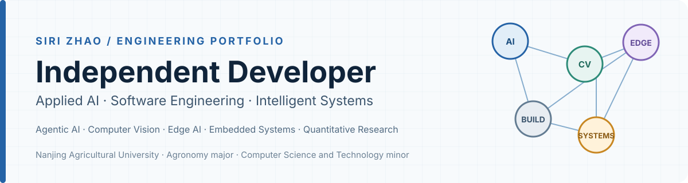
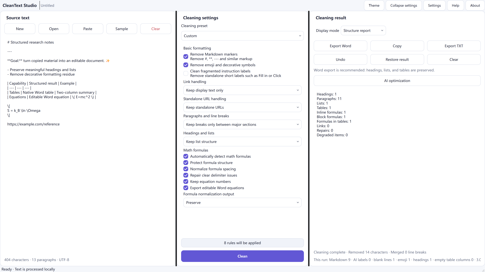
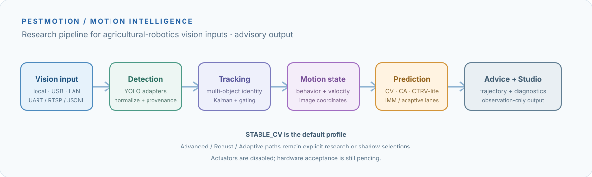
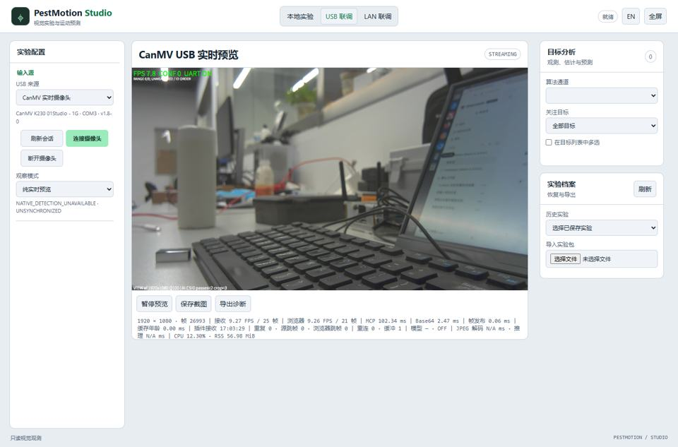
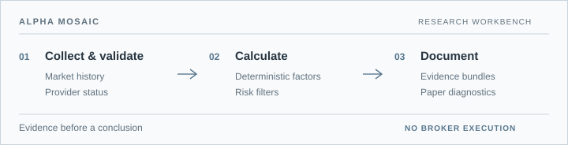
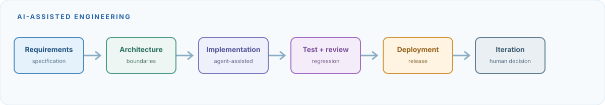

<strong>简体中文</strong> · <a href="README.md">English</a>

  <picture>
    <source media="(prefers-color-scheme: dark)" srcset="assets/profile/hero-dark.svg">
    <source media="(prefers-color-scheme: light)" srcset="assets/profile/hero-light.svg">
    
  </picture>

**Independent Developer — Applied AI, Software Engineering & Intelligent Systems**

`Agentic AI` · `Computer Vision` · `Edge AI` · `Embedded Systems` · `Quantitative Research`

<a href="#关于我">关于我</a> · <a href="#代表项目">代表项目</a> · <a href="#技术栈">技术栈</a> · <a href="#工程能力">工程能力</a> · <a href="#github-动态">GitHub 动态</a> · <a href="#联系与链接">联系</a>

我关注能够被理解、验证和持续维护的软件系统，工作方向位于**应用型人工智能、软件工程、计算机视觉、边缘计算、嵌入式系统与量化研究**的交叉处。

**南京农业大学** · 农学专业 · 计算机科学与技术辅修

## 关于我

我的主要开发语言是 Python，同时使用 C/C++ 和 JavaScript/TypeScript。我习惯把一个想法从需求说明推进到系统设计、模块实现、测试、打包和发布。目前的工作包括跨平台文档软件、私有智能农业机器人科研系统，以及强调证据链的量化研究工具。

这些项目共享同一种研究工程方法：先做出可用原型，再记录真正完成的验证，让不确定性保持可见，并留下能够被他人检查和扩展的系统。

## 代表项目

### 01 / CleanText Studio

<picture>
  <source media="(prefers-color-scheme: dark)" srcset="assets/projects/cleantext-dark.png">
  <source media="(prefers-color-scheme: light)" srcset="assets/projects/cleantext-light.png">
  
</picture>

**面向 Windows、macOS 和 Linux 的本地优先文档处理软件。** CleanText Studio 将网页复制内容、Markdown、HTML、TXT 及受支持的 DOCX 转换为可编辑文档，同时保留有用结构。其**文档结构恢复引擎**生成统一的 canonical `DocumentTree`，文本视图、预览、校验和 DOCX 导出共享同一棵树。

- 恢复 Markdown 与 HTML 中的标题、列表、链接、引用、代码、表格和段落结构。
- 原生导入 DOCX，并保留合并单元格与来源结构信息。
- 以统一公式 AST 处理受支持的 LaTeX 与 Word OMML，导出可编辑的 OMML 公式。
- 导出原生 Word 表格与公式，而不是只生成纯文本近似结果。
- 清理、预览和导出默认在本机完成；AI 润色由用户明确发起且可选。
- 真实 Qt 桌面界面、自动化测试、版本化发布、跨平台打包和带校验和的交付流程。

`Python` · `Qt 桌面应用` · `Markdown / HTML / DOCX` · `LaTeX AST / OMML` · `本地优先`

[源码](https://github.com/SiriZhao/CleanText-Studio) · [v2.1.0 发布版](https://github.com/SiriZhao/CleanText-Studio/releases/tag/v2.1.0) · [全部 Releases](https://github.com/SiriZhao/CleanText-Studio/releases)

#### CleanText Studio — Anna 适配版本

Anna 适配版本复用了 CleanText 主版本的核心，并作为独立扩展工程完成了 Anna Sampling、APS Files DOCX 导入/导出及哈希校验、Schema 4 SPA 接入、Executa JSON-RPC 集成和更严格的宿主契约校验。它目前仍是**草稿、未发布的适配应用**：已冻结 `1.0.0` 应用版本并绑定 `Executa 0.1.0` 工具，但没有公开源码仓库或公开 Release 链接。因此这里将它作为 CleanText Studio 的兼容性工程成果展示，而不是第二个公开产品。

### 02 / PestMotion — 面向农业机器人的运动智能

<picture>
  <source media="(prefers-color-scheme: dark)" srcset="assets/profile/pestmotion-architecture-dark.svg">
  <source media="(prefers-color-scheme: light)" srcset="assets/profile/pestmotion-architecture-light.svg">
  
</picture>

来自本机 USB/CanMV 验证记录的真实 Windows Studio 截图；它用于展示工作台界面，不代表 Jetson/K230 硬件验收已经完成。

**面向智能农业机器人视觉输入的科研型运动智能系统。** PestMotion 将外部检测流和 K230 UART v1.1 报告转换为带类型的帧，再连接多目标跟踪、图像坐标运动估计、短时域预测、回放、诊断和仅用于观察的规划建议。

**算法工程**

多目标身份管理 · Kalman 滤波 · Mahalanobis 距离门控 · Constant Velocity 与 Constant Acceleration 预测 · 加速度补偿预测 · CTRV-lite · Prediction IMM · 自适应与 Field Adaptive 模型选择 · 行为感知运动估计 · Shadow 评估与模型比较。

**计算机视觉与 Studio**

YOLO 适配接入、检测结果归一化、OpenCV 图像处理、轨迹叠加、多源输入、本地回放和实验记录。PestMotion Studio 包含本地、USB/CanMV 与 LAN/RTSP/TCP 工作流，支持检测器和算法选择、运行快照、遥测、诊断以及面向回放的实验验证。仍在验证的能力会在项目证据中明确标记。

我在该项目中的工作重点是**视觉输入契约、归一化、跟踪、预测、可视化和建议性规划路径**。YOLO 模型训练与数据集工作属于团队职责，主页不将其表述为我的个人训练成果。

**嵌入式系统与边缘部署**

NVIDIA Jetson Orin NX 16GB 与 Kendryte K230 是目标集成平台，涉及 ARM64/aarch64、Ubuntu Linux、UART、USB、LAN/TCP/RTSP 和离线部署流程。CUDA 与 TensorRT 属于部署环境和集成路径；这里不笼统声称具备 GPU 底层开发专长。Windows 软件和 Studio 层面已有本机证据，但真实 Jetson/K230 硬件验收、ARM64 运行验证和长期现场质量仍待完成。

**证据边界**

安全默认是 `STABLE_CV`（legacy tracker + CV predictor）。Robust、IMM、Adaptive 和其他高级 profile 仍需显式选择或作为 shadow 研究路径运行。USB 稳定性首轮测试曾出现浏览器/网络暂停，因此按限制处理并等待复测；系统没有电机、激光、PWM、CAN 或执行器闭环，执行器保持禁用。

`科研项目` · `Private repository` · `硬件验收待完成`

### 03 / Alpha Mosaic

<picture>
  <source media="(prefers-color-scheme: dark)" srcset="assets/projects/alpha-dark.svg">
  <source media="(prefers-color-scheme: light)" srcset="assets/projects/alpha-light.svg">
  
</picture>

以证据为先的量化研究工作台，覆盖市场观察、确定性因子、候选研究、纸面评估和可审计报告。项目明确处理金融数据管线、来源与校验、确定性评估、研究自动化和可复现报告；没有券商连接、下单路径，也不宣称已经证明 Alpha。

`Python` · `数据校验` · `因子研究` · `确定性评估` · `研究自动化`

[源码](https://github.com/SiriZhao/alpha-mosaic) · [架构](https://github.com/SiriZhao/alpha-mosaic/blob/main/ARCHITECTURE.md)

### 04 / Meridian Alpha

Meridian Alpha 是独立的量化决策支持基础设施项目，将研究证据连接到有状态工作流、确定性风险检查、状态感知报告和持久化纸面交易账本。当前边界为 **`PAPER_ONLY`**：已禁用券商下单和真实账户执行，也不宣称真实收益或超额收益。

`Python` · `有状态工作流` · `风险管理` · `纸面账本` · `证据驱动研究`

[源码](https://github.com/SiriZhao/meridian-alpha) · [系统边界](https://github.com/SiriZhao/meridian-alpha/blob/main/docs/adr/ADR-001-system-boundaries.md)

## 其他项目

**[RecallForge AI](https://github.com/SiriZhao/recallforge-ai)** — 基于 FastAPI + React 的学习工作台，将课程材料转换为带来源锚点的复习内容、主动回忆、练习和可导出的 Markdown、DOCX、PDF 与 Anki 卡片。生成内容始终是需要回到来源核对的学习辅助材料。[v0.6.0 发布版](https://github.com/SiriZhao/recallforge-ai/releases/tag/v0.6.0)

**[RecallForge Skill](https://github.com/SiriZhao/recallforge-skill)** — 在宿主环境执行的 Agent Skill，用于检查学习材料、重建课程知识、测试回忆并定位已表现出的薄弱点。当前版本为 v2.2.0，视觉路径会根据宿主能力明确标注。[最新 Release](https://github.com/SiriZhao/recallforge-skill/releases/latest)

## 技术栈

| 能力领域 | 实际使用的技术与方法 |
| --- | --- |
| **编程语言** | **主要：** Python · **也使用：** C、C++、JavaScript、TypeScript |
| **软件与应用开发** | Qt 桌面应用 · FastAPI · React · SQLite · REST APIs · 模块化架构 · 文档与数据管线 |
| **AI 与 Agentic Systems** | LLM 集成 · Agent Skills · MCP · Tool Calling · 工作流编排 · 上下文管理 · 评估与人工监督 |
| **计算机视觉与算法** | OpenCV · YOLO 集成 · 多目标跟踪 · Kalman 滤波 · Mahalanobis 门控 · 运动预测 · 自适应模型选择 |
| **嵌入式与边缘计算** | Jetson Orin NX · Kendryte K230 · Linux · ARM64 · UART · USB · TCP/IP · RTSP · 边缘部署流程 |
| **工程与 DevOps** | Git · GitHub · GitHub Actions · Docker · pytest · CI/CD · 调试 · 基准测试 · 跨平台打包 |
| **量化研究** | 金融数据处理 · 因子研究 · 纸面评估 · 回测诊断 · 风险评估 · 可复现报告 |

## 工程能力

| 能力 | 能够从想法推进到的结果 |
| --- | --- |
| **软件工程** | 将需求转化为系统边界，完成模块实现、稳定接口、测试、版本打包、变更记录和升级路径。CleanText Studio 是最直接的产品案例。 |
| **算法工程** | 实现状态估计与预测，设计受控实验，比较模型，检查失败模式，并在复杂候选尚未达到默认门槛时保留可解释的基线。PestMotion 体现了这套流程。 |
| **软硬件集成** | 准备设备输入契约、UART/USB/TCP 通信路径、运行时配置、诊断和分阶段部署检查，把未验证的板端行为与主机证据分开。 |
| **产品工程** | 将真实工作流落成可用的桌面或浏览器工作台，定义交互状态，让运行结果可见，并围绕实际使用迭代功能。 |
| **质量与可靠性** | 使用单元、集成、回归、性能和发布检查；分析失败；保存哈希与清单；准确说明通过的测试能够证明什么、不能证明什么。 |
| **科研工程** | 构建带实验轨迹的原型：版本化输入、尽可能确定性的运行、来源可追溯报告、可复现产物和明确限制。 |

## AI 辅助工程与 Agentic Development

<picture>
  <source media="(prefers-color-scheme: dark)" srcset="assets/profile/ai-engineering-dark.svg">
  <source media="(prefers-color-scheme: light)" srcset="assets/profile/ai-engineering-light.svg">
  
</picture>

我把 AI 编程 Agent 当作工程协作者：使用结构化规格、并行任务拆解、迭代实现、自动化测试、代码评审和人工技术决策，把想法推进为可验证的软件系统。

这套工作方式包括规格驱动开发、仓库级代码理解、Prompt Engineering、在合适时使用多 Agent 编排、AI 辅助调试与重构、回归验证、发布工程以及对生成变更的独立审查。根据任务与环境，我会使用 Codex、Claude Code 和 DeepSeek Harness；最终的技术决策、测试解释和发布边界仍由人负责。

## 科研与职业方向

我关注以下方向的科研合作与技术实习机会：

`Software Engineering` · `Applied AI & Agentic Systems` · `Computer Vision` · `Algorithm Engineering` · `Edge AI & Embedded Systems` · `Robotics and Intelligent Systems` · `Research Engineering` · `Intelligent Agriculture and Industrial Automation`

## GitHub 动态

主页前面的项目说明比贡献计数更能说明问题。这里保留公开仓库活动的静态记录，并由现有 profile workflow 自动生成。

<picture>
  <source media="(prefers-color-scheme: dark)" srcset="assets/generated/activity-dark.svg">
  <source media="(prefers-color-scheme: light)" srcset="assets/generated/activity-light.svg">
  
</picture>

贡献轨迹

<picture>
  <source media="(prefers-color-scheme: dark)" srcset="assets/generated/snake-dark.svg">
  <source media="(prefers-color-scheme: light)" srcset="assets/generated/snake-light.svg">
  
</picture>

[Profile activity workflow](https://github.com/SiriZhao/SiriZhao/actions/workflows/activity.yml) 只负责重新生成这些资产，不伪造贡献数、Star 数、语言统计或编程时长。

## 联系与链接

- [GitHub 主页](https://github.com/SiriZhao)
- [公开仓库](https://github.com/SiriZhao?tab=repositories)
- [CleanText Studio](https://github.com/SiriZhao/CleanText-Studio)
- [Alpha Mosaic](https://github.com/SiriZhao/alpha-mosaic)
- [Meridian Alpha](https://github.com/SiriZhao/meridian-alpha)

欢迎交流应用型 AI、科研工程、软件系统和技术实习机会。目前这里维护的公开联系入口是 GitHub。

